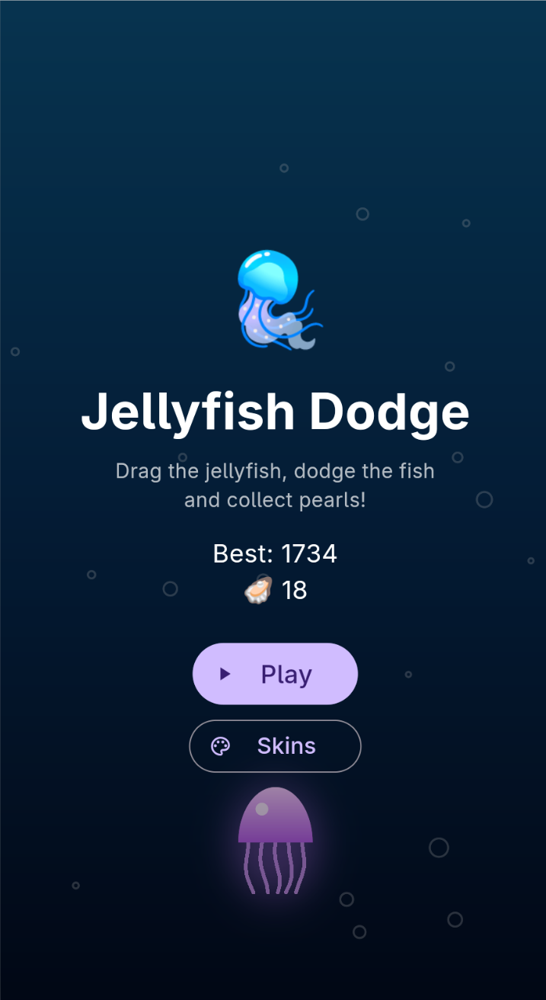
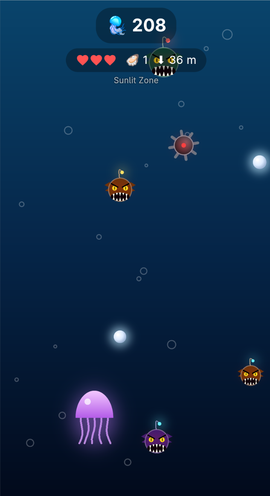
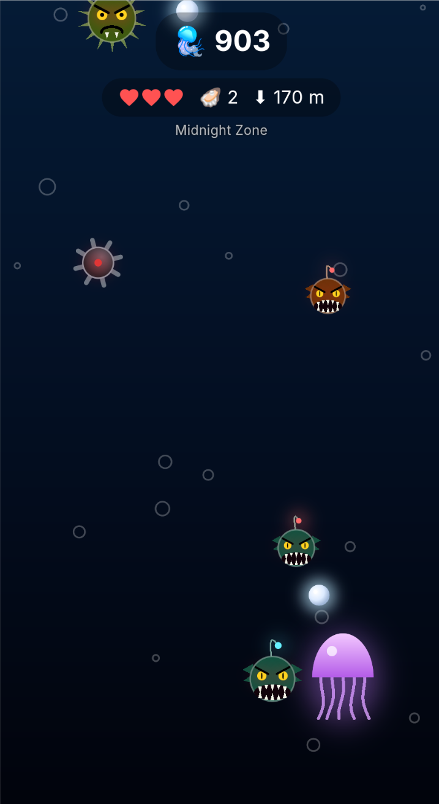
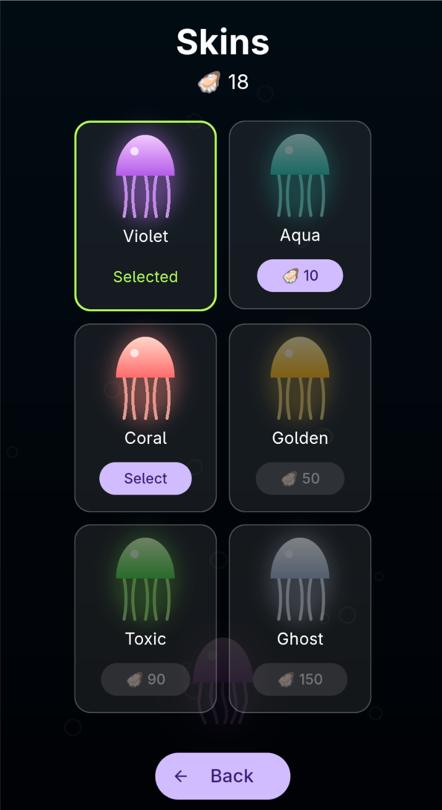

<div align="center">

# 🪼 Jellyfish Dodge

**Dive into the deep sea, dodge angry anglerfish and collect pearls.**

A fast, atmospheric 2D arcade game built with **Flutter** and the **Flame** engine.

   

</div>

## The game

You are a little jellyfish drifting down into the dark. Drag left and right to
steer, dodge everything that wants to bite you and grab as many pearls as you
can. The deeper you get, the darker, faster and meaner it becomes.

### Features

- 🦈 **Three kinds of fish**
  - **Anglerfish** – the common one. Dark body, glowing lure, a mouth full of fangs.
  - **Viperfish** – slim and fast, dives diagonally.
  - **Spikefish** – big and slow, sways from side to side.
- 💣 **Sea mines** – drift down from about 10 seconds on, get more frequent the deeper you go.
- 🦪 **Pearls** – collect them for bonus points and to unlock skins. Some float right next to a fish, risk and reward.
- ✨ **Golden pearls** – rare. They grant a **Golden Shield**: 5 seconds of invulnerability plus a magnet that pulls in nearby pearls.
- ❤️ **Three lives** – a hit costs a heart, followed by a short blink of invulnerability.
- 🌊 **Depth** – 2 m per second. The water changes from the *Sunlit Zone* through the *Twilight Zone* to the *Midnight Zone* and gets darker the deeper you dive.
- 🎨 **Unlockable skins** – six jellyfish colours (Violet, Aqua, Coral, Golden, Toxic, Ghost) bought with pearls.
- 💾 **Saved progress** – best score, pearls, unlocked skins and your selection persist between sessions.
- 🎵 **Soundtrack** – looping background music (see below).
- 📱 **Mobile ready** – portrait layout, edge-to-edge display for modern Android, and a 9:16 window on desktop.

### Controls

| Action | Input |
| --- | --- |
| Move the jellyfish | Drag left / right (finger or mouse) |

Everything else is tapping the buttons in the menus.

## Run it

You need the [Flutter SDK](https://docs.flutter.dev/get-started/install).

```bash
git clone https://github.com/R13N3K3/jellyfish-doge.git
cd jellyfish-doge
flutter pub get
flutter run -d linux      # or: -d android / -d ios / -d windows / -d macos
```

For Linux desktop builds you additionally need `clang`, `cmake`, `ninja` and
the GTK 3 development files.

### Soundtrack

The repository does **not** ship the music, because the track used during
development is third-party material. The game runs fine without it. To get
music, put any MP3 file at:

```
assets/audio/soundtrack.mp3
```

and run the game again. It loops automatically.

## Project layout

```
lib/main.dart      Game, components, overlays (all in one file)
assets/audio/      Put soundtrack.mp3 here
screenshots/       Images used in this README
android/ ios/ linux/   Platform projects
```

Inside `lib/main.dart`:

| Class | Purpose |
| --- | --- |
| `JellyfishGame` | Game loop, spawning, difficulty, lives, depth, saving |
| `JellyfishComponent` | The player: floating, pulsing, shield, skins |
| `AnglerFishComponent`, `ViperFishComponent`, `SpikeFishComponent` | The fish |
| `MineComponent`, `PearlComponent` | Hazard and collectible |
| `MainMenuOverlay`, `SkinsOverlay`, `HudOverlay`, `GameOverOverlay` | Flutter UI on top of the game |

All fish, mines, pearls and the jellyfish are drawn with plain canvas shapes,
there are no image assets.

## Developer flags

Handy for taking screenshots or testing later difficulty:

```bash
flutter run -d linux --dart-define=DEMO=true            # skip the menu, no damage
flutter run -d linux --dart-define=DEMO=true --dart-define=START_ELAPSED=75   # start 75 s into a run
flutter run -d linux --dart-define=SCREEN=skins         # open the skins menu directly
```

## Built with

[Flutter](https://flutter.dev) · [Flame](https://flame-engine.org) ·
[flame_audio](https://pub.dev/packages/flame_audio) ·
[shared_preferences](https://pub.dev/packages/shared_preferences)
